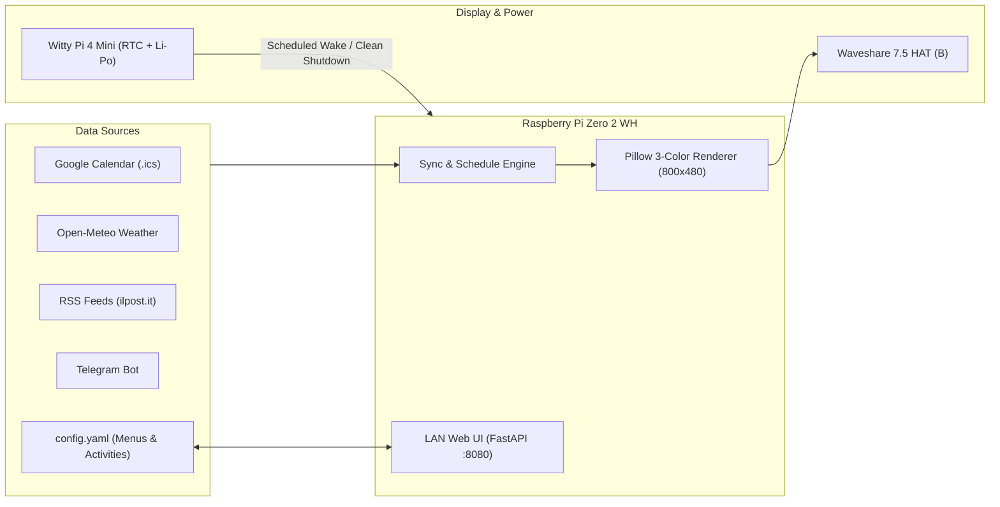

# Plug-and-Play 7.5" 3-Color E-Paper Smart Calendar

An open-source, zero-soldering, battery-friendly smart family calendar built around a **Waveshare 7.5" 3-Color (Black / White / Red) E-Paper display**, a **Raspberry Pi Zero 2 W / WH**, and a **Witty Pi 4 L3V7** (or **Witty Pi 4 Mini** / **PiSugar 3**) housed inside an off-the-shelf **IKEA RÖDALM (21×30 cm)** or **SANNAHED (25×25 cm)** frame.

---

## Features

- **Crisp 3-Color E-Paper Dashboard (800×480)**: High-contrast Black, White, and Red layout that looks like printed paper on a wall or desk—no backlight glare.
- **Google Calendar Sync**: Pulls events (including recurring events) directly from public or private `.ics` iCal feeds.
- **Context-Aware Time-of-Day Windows**: Automatically shifts focus between *Morning* (weather, commute, today's agenda, school lunch), *Afternoon* (activities, news), and *Evening* (tomorrow's preview).
- **Local Weather & News**: Uses Open-Meteo (no API key required) and RSS feeds (e.g., `ilpost.it`).
- **Fixed Weekly Activities & School Menu**: Easy YAML/Web UI management for recurring kid/family routines and daily school meals.
- **Telegram Integration**: Send quick notes or reminders to the display from your phone.
- **LAN Web UI (Port 8080)**: Password-protected FastAPI portal to edit `config.yaml`, update menus/activities, and trigger manual refreshes from any browser on your local network.
- **True Battery Wake-Up Mode**: Witty Pi 4 L3V7 (for 3.7V Li-Po) or Witty Pi 4 Mini (for 5V USB-C / power bank) powers the Pi on only for scheduled refreshes (or on-demand button press), then cleanly cuts power for multi-week battery operation.

---

## Plug-and-Play Bill of Materials (BOM) — Verified Availability (Nov 2026)

No soldering required—every component connects via pre-soldered or hammer-in GPIO headers and plug-in JST/USB-C connectors. Because several maker components frequently go out of stock in EU stores, each row includes **verified in-stock sources** and **drop-in alternatives**.

| Component | Recommended Part (In Stock) | Verified Alternatives (If Out of Stock) | Est. Price (EU) |
| :--- | :--- | :--- | :---: |
| **Display (7.5" 800×480)** | **Waveshare 7.5" e-Paper HAT (B)** (B/W/R, SKU 13505) — [Waveshare Direct](https://www.waveshare.com/7.5inch-e-paper-hat-b.htm) *(Kiwi Electronics restock 26 Nov 2026)* | • **Waveshare 7.5" HAT v2 (B/W)** — [BerryBase EU](https://www.berrybase.de/en/7.5-800-480-epaper-display-hat-for-raspberry-pi-v2) *(In stock, 4s refresh, **-6.3% sale €59.90**; uses `epd7in5_V2`)*<br>• **Waveshare 7.5" Four-Color HAT (H)** (R/Y/B/W) — [The Pi Hut](https://thepihut.com/products/7-5-four-colour-epaper-display-h-with-driver-hat-for-raspberry-pi) *(In stock, £56 / ~€66)* | ~€52–€66 |
| **Compute** | **Raspberry Pi Zero 2 W (with pre-soldered header)** — [The Pi Hut](https://thepihut.com/products/raspberry-pi-zero-2) *(In stock, £17.30 / ~€20.50; EU VAT/IOSS included)* | • **Pi Zero 2 W (no header, £14.40)** + **[Pimoroni Solderless GPIO Hammer Header + Jig](https://thepihut.com/products/gpio-hammer-header-solderless)** (£7.20, in stock, zero soldering)<br>• **Raspberry Pi Zero WH** — [BerryBase EU](https://www.berrybase.de/) *(In stock €18.90, 32-bit, slower ~60s sync)* | ~€19–€26 |
| **Power Mgmt & RTC** | **UUGear Witty Pi 4 L3V7** — [UUGear Direct EU](https://www.uugear.com/product/witty-pi-4-l3v7/) *(In stock, €25.50; built-in 3.7V Li-Po charger + 5V/3A boost + PH2.0 cable)* | • **UUGear Witty Pi 4 Mini** — [UUGear Direct EU](https://www.uugear.com/product/witty-pi-4-mini/) *(In stock, €20.00; **5V USB-C input only** — use with power bank or wall adapter, NOT direct 3.7V Li-Po)*<br>• **PiSugar 3 (1200 mAh)** — [Tindie](https://www.tindie.com/products/pisugar/pisugar-3-battery-for-raspberry-pi-zero/) *(In stock, ~$35–$40; all-in-one battery + RTC via pogo pins, frees all 40 GPIO pins)* | ~€20–€26 |
| **Battery** | **Soldered Li-Po 3.7V 3000 mAh (JST-PH 2.0, PCM)** — [BerryBase EU](https://www.berrybase.de/soldered-li-ion-akku-lithium-polymer-605080-3-7v-3000mah-mit-2-pin-jst-stecker) *(In stock, €12.00; ultra-thin 5.7 mm; check polarity before connecting)* | • **Compact USB-C Power Bank (10,000 mAh)** with trickle-charge/low-current mode (e.g., Anker / UGREEN) for Witty Pi 4 Mini<br>• **5V/2.5A USB-C Wall Adapter** (€7.90 at BerryBase) for always-on cord mode | ~€8–€15 |
| **Storage** | **microSD 32 GB or 64 GB Class A1** (SanDisk Ultra / Kingston Canvas Select Plus / Verbatim) — Amazon.it / BerryBase | Any branded A1/A2 Class 10 microSD card (64 GB often costs nearly the same as 32 GB during promos) | ~€8–€15 |
| **Frame** | **IKEA RÖDALM 21×30 cm** — [IKEA Italia](https://www.ikea.com/it/it/cat/roedalm-serie-700545/) *(In stock, €7.50; replaces discontinued SANNAHED 21×30 cm; includes passe-partout + deep removable inner spacer)* | • **IKEA SANNAHED 25×25 cm** (available on IKEA Italia for a square wall-mount format) | €7.50 |
| **Cables & Mounting** | Short right-angle USB-C cable (20–30 cm) + masking tape / 3M Velcro strips | Local hardware store / Amazon.it | ~€3–€5 |

**Estimated Total (Plug-and-Play, VAT incl., excl. shipping):** **~€118 – €150** *(see [docs/lista_spesa_bom_it.pdf](docs/lista_spesa_bom_it.pdf) for the full Italian procurement guide with clickable EU links).*

> **Important Power Note:** Do **not** plug a 3.7V Li-Po battery directly into a **Witty Pi 4 Mini** (it only accepts 5V DC via USB-C). For direct 3.7V Li-Po battery operation, use **Witty Pi 4 L3V7** (which includes an onboard TP4056 charger, 5V/3A boost converter, and JST-PH 2.0 cable) and always verify `+`/`-` pin polarity before connecting the battery.

### Black Friday 2026 Discounts & Deals (Checked 21 Nov 2026)

Black Friday 2026 falls on **27 November 2026** (Cyber Monday **30 November 2026**), and early deals are already live:

- **BerryBase EU Sale% (Live Now):** **Waveshare 7.5" e-Paper HAT v2 (B/W)** discounted to **€59.90** (was €63.90, **-6.3%**, 80 pcs in stock).
- **Amazon.it Black Friday Week (19–30 Nov 2026 — Live Now):** Active discounts on **SanDisk Ultra/Extreme & Lexar A1/A2 microSD cards**, **Anker/UGREEN USB-C power banks** (up to **30–46% off** on Anker's Black Friday sale), right-angle USB-C cables, and 3M Command/Velcro strips.
- **LaskaKit EU Black Friday (Live Now):** **-7% to -8%** off 1,650+ maker components (displays, cables, connectors, power modules) at [laskakit.cz/en/black-friday/](https://www.laskakit.cz/en/black-friday/) (free EU shipping over €100).
- **Watchlist for 27–30 Nov (Black Friday / Cyber Monday):** **The Pi Hut** and **Pimoroni** traditionally run 24-hour / weekend sales (**10–20% off** HATs, displays, and accessories; bare Raspberry Pi boards are rarely discounted, so grab the Zero 2 W while in stock). **Kiwi Electronics** expects a restock of the 3-color **Waveshare 7.5" HAT (B)** on **26 Nov 2026**.

> **Tip:** An optional 3D-printed passe-partout / rear spacer (files planned under `enclosure/`) keeps the 7.5" panel centered behind the IKEA mat and leaves room for the Li-Po battery and Witty Pi stack.

---

## Architecture



---

## How LAN Web UI + Battery Wake-Up Mode Work Together

Running on a Li-Po battery means the Raspberry Pi is **powered off most of the day** to preserve charge. Here is how configuration and updates work seamlessly:

1. **Scheduled Wake-Up Cycle**:
   - The **Witty Pi 4 Mini** wakes the Pi at your configured intervals (e.g., `06:45`, `12:30`, `18:30`).
   - On boot, the calendar service fetches fresh iCal events, Open-Meteo weather, RSS headlines, and any queued Telegram notes, renders the 3-color image, updates the Waveshare e-Paper display, and signals a clean shutdown.
2. **Editing Settings via the LAN Web UI (`http://<pi-ip>:8080`)**:
   - **Always-On / USB Maintenance**: Plugging in USB-C power (or toggling *Maintenance Mode* via the Witty Pi button / Web UI) keeps the Pi awake so you can browse to `http://<pi-ip>:8080` at any time.
   - **During a Wake Window**: If you open the Web UI while the Pi is awake, you can pause the auto-shutdown timer, update `config.yaml` (school menu, weekly activities, Wi-Fi/API settings), preview the rendered image in your browser, and push an immediate refresh to the screen.
   - Once you finish or the `maintenance_timeout_minutes` window expires, the Pi resumes normal battery wake-up scheduling.

---

## Quick Start

### 1. Clone the Repository

```bash
git clone https://github.com/your-org/smart-epaper-calendar.git
cd smart-epaper-calendar
```

### 2. Set Up a Python Virtual Environment

```bash
python3 -m venv .venv
source .venv/bin/activate
pip install -r requirements.txt
```

### 3. Configure

```bash
cp config.example.yaml config.yaml
```

Edit `config.yaml` with your:
- Google Calendar `.ics` URL(s)
- Home/Office coordinates & Open-Meteo latitude/longitude
- Telegram bot token (optional)
- LAN Web UI password hash & session secret
- Time-of-day windows, weekly activities, and school meal menu

### 4. Run (Coming Soon)

- **Preview / Dev Mode**: Generates `output/preview.png` locally without requiring e-Paper hardware.
- **LAN Web UI**: `uvicorn app.web:app --host 0.0.0.0 --port 8080`

---

## Repository Structure

```text
smart-epaper-calendar/
├── config.example.yaml   # Documented configuration template
├── LICENSE               # MIT License
├── README.md             # Project overview, BOM, architecture, and setup
└── requirements.txt      # Python dependencies
```

---

## License

This project is licensed under the **MIT License** — see [LICENSE](LICENSE) for details.
