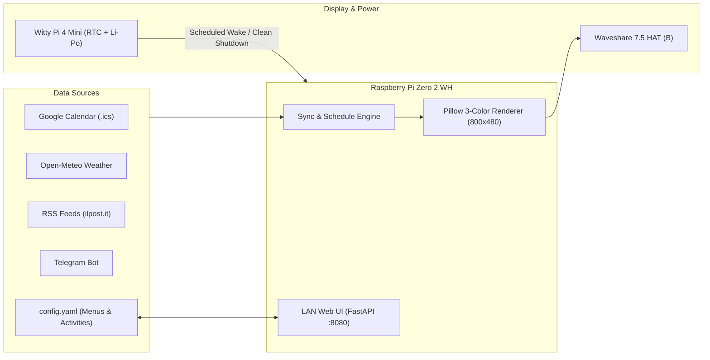

# Plug-and-Play 7.5" 3-Color E-Paper Smart Calendar

An open-source, zero-soldering, battery-friendly smart family calendar built around a **Waveshare 7.5" 3-Color (Black / White / Red) E-Paper display**, a **Raspberry Pi Zero 2 WH**, and a **Witty Pi 4 Mini** housed inside an off-the-shelf **IKEA SANNAHED / RÖDALM** frame.

---

## Features

- **Crisp 3-Color E-Paper Dashboard (800×480)**: High-contrast Black, White, and Red layout that looks like printed paper on a wall or desk—no backlight glare.
- **Google Calendar Sync**: Pulls events (including recurring events) directly from public or private `.ics` iCal feeds.
- **Context-Aware Time-of-Day Windows**: Automatically shifts focus between *Morning* (weather, commute, today's agenda, school lunch), *Afternoon* (activities, news), and *Evening* (tomorrow's preview).
- **Local Weather & News**: Uses Open-Meteo (no API key required) and RSS feeds (e.g., `ilpost.it`).
- **Fixed Weekly Activities & School Menu**: Easy YAML/Web UI management for recurring kid/family routines and daily school meals.
- **Telegram Integration**: Send quick notes or reminders to the display from your phone.
- **LAN Web UI (Port 8080)**: Password-protected FastAPI portal to edit `config.yaml`, update menus/activities, and trigger manual refreshes from any browser on your local network.
- **True Battery Wake-Up Mode**: Witty Pi 4 Mini powers the Pi on only for scheduled refreshes (or on-demand button press), then cleanly cuts power for multi-week battery operation.

---

## Plug-and-Play Bill of Materials (BOM)

No soldering required—every component connects via pre-soldered GPIO headers or plug-in JST connectors.

| Component | Recommended Part | Purpose |
| :--- | :--- | :--- |
| **Display** | Waveshare 7.5" e-Paper HAT (B) V3 (800×480, Red/Black/White) | Ultra-low-power tri-color e-ink screen + SPI HAT |
| **Compute** | Raspberry Pi Zero 2 WH (with pre-soldered 40-pin header) | Runs Python renderer, FastAPI Web UI, and sync tasks |
| **Power Management** | UUGear Witty Pi 4 Mini | Real-Time Clock (RTC) + scheduled wake-up & safe power cut |
| **Battery** | 3.7V Li-Po Battery (2000–5000 mAh, JST-PH 2.0 connector) | Cord-free wall-mount power |
| **Frame** | IKEA SANNAHED (25×25 cm) or RÖDALM frame | Clean, affordable off-the-shelf picture frame |
| **Storage** | microSD Card (16 GB+ A1/Class 10) | Raspberry Pi OS Lite + application data |

> **Tip:** An optional 3D-printed passe-partout / rear spacer (files planned under `enclosure/`) keeps the 7.5" panel centered behind the IKEA mat and leaves room for the Li-Po battery and Witty Pi stack.

---

## Architecture



---

## How LAN Web UI + Battery Wake-Up Mode Work Together

Running on a Li-Po battery means the Raspberry Pi is **powered off most of the day** to preserve charge. Here is how configuration and updates work seamlessly:

1. **Scheduled Wake-Up Cycle**:
   - The **Witty Pi 4 Mini** wakes the Pi at your configured intervals (e.g., `06:45`, `12:30`, `18:30`).
   - On boot, the calendar service fetches fresh iCal events, Open-Meteo weather, RSS headlines, and any queued Telegram notes, renders the 3-color image, updates the Waveshare e-Paper display, and signals a clean shutdown.
2. **Editing Settings via the LAN Web UI (`http://<pi-ip>:8080`)**:
   - **Always-On / USB Maintenance**: Plugging in USB-C power (or toggling *Maintenance Mode* via the Witty Pi button / Web UI) keeps the Pi awake so you can browse to `http://<pi-ip>:8080` at any time.
   - **During a Wake Window**: If you open the Web UI while the Pi is awake, you can pause the auto-shutdown timer, update `config.yaml` (school menu, weekly activities, Wi-Fi/API settings), preview the rendered image in your browser, and push an immediate refresh to the screen.
   - Once you finish or the `maintenance_timeout_minutes` window expires, the Pi resumes normal battery wake-up scheduling.

---

## Quick Start

### 1. Clone the Repository

```bash
git clone https://github.com/your-org/smart-epaper-calendar.git
cd smart-epaper-calendar
```

### 2. Set Up a Python Virtual Environment

```bash
python3 -m venv .venv
source .venv/bin/activate
pip install -r requirements.txt
```

### 3. Configure

```bash
cp config.example.yaml config.yaml
```

Edit `config.yaml` with your:
- Google Calendar `.ics` URL(s)
- Home/Office coordinates & Open-Meteo latitude/longitude
- Telegram bot token (optional)
- LAN Web UI password hash & session secret
- Time-of-day windows, weekly activities, and school meal menu

### 4. Run (Coming Soon)

- **Preview / Dev Mode**: Generates `output/preview.png` locally without requiring e-Paper hardware.
- **LAN Web UI**: `uvicorn app.web:app --host 0.0.0.0 --port 8080`

---

## Repository Structure

```text
smart-epaper-calendar/
├── config.example.yaml   # Documented configuration template
├── LICENSE               # MIT License
├── README.md             # Project overview, BOM, architecture, and setup
└── requirements.txt      # Python dependencies
```

---

## License

This project is licensed under the **MIT License** — see [LICENSE](LICENSE) for details.
